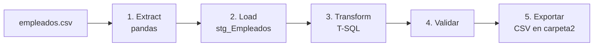

# Liquidación de sueldos – Pipeline ETL con Python y SQL Server

Pipeline ETL que lee un CSV de empleados, lo carga en SQL Server, calcula la liquidación de sueldos con SQL (T-SQL) y exporta los resultados a CSV.

**Autor:** Augusto Caceres

## ¿Qué hace?

A partir de un archivo `empleados.csv` con datos desordenados (nombres con espacios y mayúsculas mezcladas, departamentos escritos de varias formas, evaluaciones vacías), el pipeline:

1. **Extract:** lee el CSV con pandas.
2. **Load:** lo carga tal cual en la tabla de staging `stg_Empleados`.
3. **Transform:** con SQL limpia los datos y calcula antigüedad, bonos, horas extra, bruto, aportes, neto y cuartil. Genera las tablas `liquidacion` y `reporte_departamentos`.
4. **Validar:** controla que la cantidad de filas coincida y que no haya salarios netos nulos o menores o iguales a 0.
5. **Exportar:** guarda los resultados como CSV en `carpeta2`.



## Stack

- Python 3 con `pandas` y `pyodbc`
- SQL Server (T-SQL), con ODBC Driver 17 for SQL Server
- Autenticación de Windows (`Trusted_Connection=yes`)

## Estructura del proyecto

```
.
├── carpeta1/
│   └── empleados.csv                    # datos de entrada
├── carpeta2/                            # resultados (se crea al ejecutar)
├── liquidacion_sueldos_sqlserver.py     # pipeline completo (Python + SQL Server)
├── liquidacion_sqlserver_simple.sql     # solo la parte de SQL (Transform y validación)
└── README.md
```

La carpeta de salida `carpeta2` se toma como carpeta hermana de la carpeta donde está el CSV.

## Datos de entrada

`empleados.csv` tiene 16 empleados y las columnas `id_empleado`, `nombre`, `departamento`, `fecha_ingreso`, `salario_base`, `evaluacion` y `horas_extra`. Está desordenado a propósito, para practicar la limpieza en SQL:

- Nombres con espacios sobrantes y mayúsculas mezcladas (`"  maria LOPEZ"`, `"JUAN perez "`).
- Departamentos escritos de varias formas (`"ventas"`, `" VENTAS"`, `"Ventas"`).
- Tres evaluaciones vacías (ids 3, 7 y 11).

## Requisitos

- Python 3.9 o superior.
- Una instancia de SQL Server accesible desde tu PC.
- ODBC Driver 17 for SQL Server.
- Dependencias de Python:

```bash
pip install pandas pyodbc
```

## Configuración

Al inicio de `liquidacion_sueldos_sqlserver.py` están los parámetros que hay que adaptar:

| Parámetro | Qué es |
|---|---|
| `file_path` | Ruta completa a `empleados.csv` |
| `SERVER` | Nombre de tu instancia de SQL Server |
| `DATABASE` | Base de datos donde se crean las tablas (por defecto `TestDB`; se crea si no existe) |
| `FECHA_LIQUIDACION` | Fecha hasta la cual se cuenta la antigüedad (por defecto `2026-10-31`) |
| `PCT_APORTES` | Porcentaje de aportes sobre el bruto (por defecto `17`) |

Si tu SQL Server usa usuario y contraseña en vez de Windows Authentication, cambiá la cadena de conexión en la función `conectar`.

## Cómo ejecutarlo

### Opción A: pipeline completo con Python

```bash
python liquidacion_sueldos_sqlserver.py
```

Ejecuta las cinco etapas en orden. Si un paso del SQL falla, el script muestra cuál fue y se detiene.

### Opción B: solo la parte de SQL

1. Tener cargada la tabla `stg_Empleados`, ya sea ejecutando la opción A o con el asistente "Importar archivo plano" de SSMS.
2. Abrir `liquidacion_sqlserver_simple.sql` en SSMS, Azure Data Studio o VS Code (con la extensión *SQL Server (mssql)*), conectado a la base de datos.
3. Ejecutar el script completo. Los parámetros están en las dos líneas `DECLARE` del principio.
4. Guardar los resultados de los `SELECT` finales como CSV desde el panel de resultados.

## Etapa Transform

El SQL se ejecuta en pasos cortos. Cada uno usa las columnas calculadas por el anterior, así que el orden importa.

| Paso | Qué hace |
|---|---|
| 0 | Borra la tabla `liquidacion` anterior |
| 1 | Copia limpia de `stg_Empleados`: quita espacios, pasa el departamento a mayúsculas, completa las evaluaciones vacías con 3 y calcula la antigüedad |
| 2 | Genera el email y da formato al nombre |
| 3 | Calcula bono por antigüedad, bono por evaluación y pago de horas extra |
| 4 | Calcula salario bruto, aportes y salario neto |
| 5 | Asigna el cuartil según el neto |
| 6 | Arma el reporte `reporte_departamentos` |

### Reglas de negocio

| Concepto | Regla |
|---|---|
| Evaluación vacía | Se toma como 3 |
| Antigüedad | Años completos cumplidos hasta la fecha de liquidación |
| Bono por antigüedad | 2% del salario base por año, con un tope de 20% |
| Bono por evaluación | 5 → 15%, 4 → 10%, 3 → 5%, 1 o 2 → 0% del salario base |
| Horas extra | `horas_extra × (salario_base / 160) × 1.5` |
| Salario bruto | Salario base + bono por antigüedad + bono por evaluación + horas extra |
| Aportes | 17% del salario bruto |
| Salario neto | Salario bruto − aportes |
| Cuartil | De 1 a 4 según el neto, donde 1 son los más bajos |
| Redondeo | 2 decimales en cada bono, en las horas extra y en los aportes |

### Tablas resultantes

- **`liquidacion`:** una fila por empleado, con `id_empleado`, `nombre`, `departamento`, `email`, `evaluacion`, `salario_base`, `horas_extra`, `antiguedad_anios`, `bono_antiguedad`, `bono_evaluacion`, `pago_horas_extra`, `salario_bruto`, `aportes`, `salario_neto` y `cuartil_neto`.
- **`reporte_departamentos`:** una fila por departamento, con `cantidad_empleados`, `masa_salarial_bruta`, `neto_promedio`, `participacion_pct`, `mayor_neto` y `empleado_mayor_neto`.

## Resultados esperados

Con los datos de ejemplo, la fecha `2026-10-31` y 17% de aportes:

- `liquidacion` tiene 16 filas.
- Totales: bruto 28251656.25, aportes 4802781.57, neto 23448874.68.
- Maria Lopez: 14 años de antigüedad (bono en el tope del 20%, 320000.00), bruto 2250000.00, aportes 382500.00, neto 1867500.00, cuartil 4, email `maria.lopez@empresa.com`.
- Diego Sosa tiene 5 años (ingresó el 2021-10-31) y Camila Diaz 4 (ingresó el 2021-11-02): caso de borde del aniversario.
- Lucia Fernandez no tiene evaluación; se toma como 3 y su bono de evaluación es 50000.00.
- Romina Paz: aportes 223348.13 (el valor exacto 223348.125 se redondea hacia arriba) y neto 1090464.37.

| Departamento | Empleados | Masa bruta | Neto promedio | Participación | Mayor neto | Empleado |
|---|---|---|---|---|---|---|
| SISTEMAS | 5 | 11119500.00 | 1845837.00 | 39.4 | 2776350.00 | Martin Gomez |
| VENTAS | 5 | 8671312.50 | 1439437.87 | 30.7 | 1867500.00 | Maria Lopez |
| LOGISTICA | 3 | 4624218.75 | 1279367.19 | 16.4 | 1452500.00 | Hernan Ruiz |
| RRHH | 3 | 3836625.00 | 1061466.25 | 13.6 | 1305590.00 | Valentina Lopez |

Las participaciones suman 100.1 y no 100, por el redondeo a 1 decimal.

## Decisiones de diseño

- **Limpieza en SQL, no en pandas.** El CSV se carga sin tocar los datos, así la tabla de staging conserva el original y toda la lógica de negocio queda en SQL.
- **Un paso por cálculo dependiente.** En un `UPDATE`, todas las expresiones usan los valores que la fila tenía antes de la sentencia. Por eso el bruto, los aportes y el neto van en pasos separados.
- **Columnas creadas con `CAST(NULL AS tipo)`.** Nacen con el tipo correcto dentro del `SELECT ... INTO` y los pasos siguientes las rellenan.
- **Divisiones con decimales** (`100.0`, `160.0`) para evitar la división entera de SQL Server.
- **Pipeline repetible:** cada ejecución borra y recrea las tablas de resultado.

## Limitaciones

- El email y el formato del nombre suponen que cada nombre tiene exactamente dos palabras.
- Las fechas de ingreso que no se puedan leer quedan en NULL, y la validación lo detecta porque el neto queda nulo.
- Está pensado para SQL Server: `DATEDIFF`, `CHARINDEX`, `TOP` y `SELECT ... INTO` no son iguales en otros motores.

## Posibles mejoras

- Orquestar el pipeline con Apache Airflow (ver la versión con Airflow y Docker).
- Parametrizar las reglas de bonos desde una tabla de configuración.
- Agregar pruebas automáticas que comparen los resultados con los valores esperados.
